# 🧪 Export & Import Testing — Start Here

**Help verify that Textivo exports and restores complete editable projects without losing formatting or animation settings.**

This is the first section because project portability is one of the most important features to test.

## Test a complete project

1. Open Textivo in a modern browser.
2. Create at least three independent text lines.
3. Format different characters and words with different fonts, sizes, colors, and weights.
4. Test **bold**, *italic*, underline, and strikethrough.
5. Apply text highlights, including transparent highlights.
6. Change letter spacing, word spacing, alignment, text shadow, and canvas background.
7. Configure Motion Studio:
   - Animation mode
   - Animate by line, word, or character
   - Entrance and exit effects
   - Movement duration
   - Delay between parts
   - Pause between lines
   - Pause before exit

## Export the project

Open **Export & Projects** and test the available export actions:

| Export option | What it is for |
|---|---|
| **Project JSON** | Editable project data, including text and saved settings |
| **Animated HTML** | A portable HTML animation |
| **Export HTML** | HTML output for the composition |
| **Export SVG** | Scalable vector output |
| **Export PNG** | Static image output |
| **Copy text** | Plain-text copy |

Keep the exported JSON file. It is the file used in the restoration test below.

## Import and restore

1. Reload Textivo, or open it in another browser.
2. Choose **Import Project JSON**.
3. Select the JSON file exported in the previous step.
4. Compare the restored project with the original.

## Restoration checklist

- [ ] All independent text lines return in the correct order.
- [ ] Character-level and word-level formatting is preserved.
- [ ] Fonts, font sizes, colors, and font weights are preserved.
- [ ] Bold, italic, underline, and strikethrough are preserved.
- [ ] Highlights and transparent highlights are preserved.
- [ ] Letter spacing and word spacing are preserved.
- [ ] Alignment, text shadow, and canvas background are preserved.
- [ ] Motion mode and animation unit are preserved.
- [ ] Entrance and exit effects are preserved.
- [ ] Animation duration, delays, and pauses are preserved.
- [ ] The restored result visually matches the original.

**Important:** Do not assume an item is supported just because it appears in this checklist. Verify it in the exported file and after importing it. Report any missing or changed setting.

## Report a problem

If something is missing or changes after export/import, open a [GitHub Issue](https://github.com/Khayom1/textivo/issues) and include:

- Device and browser
- Textivo version
- Export format tested
- Steps to reproduce
- Screenshot of the original and restored result
- The JSON file, if it is safe to share

---

<div align="center">



# Textivo — Typography Studio

**Create. Style. Animate. Export.**

A multilingual, browser-based typography studio for creative text design.

</div>

---

## Live Demo

**Textivo — Your text. Your rules.**

Textivo is an independent, browser-based typography studio created by Khayom Abdurahmonov. It gives you control over individual characters, words, and independent text lines, with animation tools and multiple export formats.

## What can you create?

Textivo turns plain text into customizable typography compositions. Write your text, style selected parts, animate the result, and export your work.

### 1. Independent Line Editor

- Create separate, editable text lines.
- Add new lines with the **Add Line** button.
- Edit each line independently.

### 2. Character & Word Styling

Select a character, word, or text range and apply formatting to the selected content.

Available controls include:

- Font family
- Font size
- Text color
- Text highlight color
- Transparent text highlight
- Font weight
- Bold, italic, underline, and strikethrough
- Letter spacing
- Word spacing
- Text alignment

### 3. Canvas & Background Control

Customize the presentation background independently from text formatting.

- Canvas background color
- Default text color
- Transparent canvas
- Text highlight background
- Transparent highlight for selected text
- Text shadow

### 4. Motion Studio

Create sequential text animations with three animation units:

| Animation unit | Behavior |
|---|---|
| Whole line | Animate an entire line |
| Word by word | Reveal and animate individual words |
| Character by character | Reveal and animate individual characters |

**Entrance effects**

- Fade in
- Rise up
- Slide from left
- Zoom in
- Blur in
- Pop
- None

**Exit effects**

- Fade out
- Drop down
- Slide right
- Zoom out
- Blur out
- None

**Motion controls**

- Movement duration
- Delay between animated parts
- Pause between lines
- Pause before exit
- Play once
- Loop
- Typing only
- Deleting only

### 5. Export & Projects

Textivo provides export options for different workflows:

| Format | Purpose |
|---|---|
| Project JSON | Save project content and settings for later import |
| Animated HTML | Portable animated HTML output |
| HTML | Reusable HTML output |
| SVG | Scalable vector output |
| PNG | Static image output |
| Copy text | Copy plain text |

Project JSON is intended for reopening and continuing to edit a project in Textivo. HTML, SVG, and PNG are output formats, not substitutes for the editable project file.

### 6. Multilingual Interface

Textivo includes three interface languages:

- English
- Русский
- Тоҷикӣ

---

## Quick Start

Textivo runs locally in a modern web browser. No paid API or external backend is required for the core editing workflow.

### Run locally with Termux

```bash
cd ~/textivo
python -m http.server 8080 --bind 127.0.0.1
```

Open this address in your browser:

```text
http://127.0.0.1:8080
```

Keep Termux running while using the local server. Stop the server with `CTRL + C`.

## Technology

- HTML5
- CSS3
- JavaScript
- Web App Manifest
- Service Worker

## Project Status

Textivo is an independent project under active development. Export and import behavior should be tested using the checklist at the top of this README.

## Author

**Khayom Abdurahmonov**

Independent creator and developer.

---

<div align="center">

**Textivo — Your text. Your rules.**

</div>
