<div align="center">


# Textivo

### Your words. Your style. Your motion.

**Current release: v16** · **Text-only creative studio**

[](https://github.com/Khayom1/textivo)
[](#languages)
[](#privacy-and-local-storage)
[](#technology)

**[User guide](GUIDE.md) · [Installation](INSTALL.txt) · [Testing](TESTING.md) · [Report an issue](https://github.com/Khayom1/textivo/issues)**

</div>

---

## Product showcase

The animated product illustration below maps the studio's real feature areas: writing, character-level styling, live preview, motion controls, canvas presets, text utilities, and export workflows.

<p align="center">
  
</p>

<p align="center"><sub>Illustrative interface overview. Exact appearance and animation timing depend on the viewer's SVG support.</sub></p>

## What is Textivo?

Textivo is a browser-based typography studio for turning plain words into designed text compositions. Write in separate lines, select a precise word or character, apply visual styling, configure a canvas, preview the result, animate the typography, and export portable files.

It focuses on one job: **making text look intentional and expressive without requiring a complex graphics application.**

- Text-only by design — not a photo editor, video editor, drawing tool, or image generator.
- Local-first — no account or paid API is required for the core editor.
- Browser-native — built with HTML, CSS, and vanilla JavaScript.
- Portable output — export typography as HTML, SVG, PNG, or animated HTML.
- Multilingual interface — English, Russian, and Tajik.

## What you can create

- Quote cards and short statements
- Social-media headlines, story text, and title cards
- Announcements and promotional typography
- Study notes and educational text cards
- Animated captions and text sequences
- Simple greetings, banners, and title screens

## Feature map

| Studio area | Capabilities |
|---|---|
| **Text workspace** | Multi-line editing with separate editable line boxes; add and organize lines. |
| **Text utilities** | Character, word, and line counts; find and replace; uppercase, lowercase, and title case; normalize spaces; remove blank or duplicate lines; sort lines. |
| **Selection styling** | Select a word, phrase, or character and apply bold, italic, underline, strike-through, font family, font size, text color, highlight, letter spacing, word spacing, weight, and alignment. |
| **Canvas & background** | Landscape 16:9, Square 1:1, Story 9:16, and Portrait 4:5; background color, transparent canvas, default text color, and text shadow. |
| **Templates** | Quote card, Announcement, Study card, Creator title, and Minimal statement. |
| **Live preview** | View the formatted composition while editing. |
| **Motion Studio** | Animate by whole line, word, or character; configure entrance and exit effects, movement duration, delay, pauses, and playback mode. |
| **Playback modes** | Play once, loop, typing-only, and deleting-only modes. |
| **Project workflow** | Save projects locally in the browser; export and import editable Project JSON backups. |
| **Export** | Copy text; export HTML, SVG, PNG, and animated HTML. |

### Motion effects

Entrance effects include **Fade, Rise, Slide from left, Zoom, Blur, Pop**, and no effect. Exit effects include **Fade, Drop down, Slide right, Zoom, Blur**, and no effect.

Motion can be applied to a complete line, individual words, or individual characters. Timing controls determine how long each part moves and how much delay separates consecutive parts.

## Quick start

### Requirements

- A modern browser (Chrome, Firefox, Edge, or Safari).
- Python 3 for the simplest local server.
- Node.js 20+ only if you want to run the repository's quality checks.

### Run locally

```bash
git clone https://github.com/Khayom1/textivo.git
cd textivo
python -m http.server 8080 --bind 127.0.0.1
```

Open **http://127.0.0.1:8080** in your browser.

### Android / Termux

```bash
pkg update
pkg install git python
git clone https://github.com/Khayom1/textivo.git
cd textivo
python -m http.server 8080 --bind 127.0.0.1
```

Keep Termux running and open **http://127.0.0.1:8080** on the same device.

## Typical workflow

1. **Write** your composition in separate line boxes.
2. **Organize** it with find/replace, case conversion, and cleanup tools.
3. **Select** the exact word, phrase, or character to customize.
4. **Style** typography with font, size, weight, color, highlight, spacing, and alignment.
5. **Set the canvas** to the aspect ratio and background you need.
6. **Preview** the composition and adjust until it looks right.
7. **Animate** by line, word, or character; tune entrance, exit, and timing.
8. **Save** locally and export a Project JSON backup when you need to continue elsewhere.
9. **Export** the final composition in the format required by your workflow.

## Languages

The interface currently includes:

- 🇬🇧 English
- 🇷🇺 Russian
- 🇹🇯 Tajik

The language setting changes the application interface; it does not automatically translate the text you write.

## Export formats

| Format | Intended use | Can be re-imported as an editable project? |
|---|---|---|
| **Project JSON** | Backup, transfer, and later editing in Textivo | Yes |
| **HTML** | Portable static text composition | No |
| **Animated HTML** | Standalone animated typography presentation | No |
| **SVG** | Scalable vector typography with supported motion | No |
| **PNG** | Static image for sharing | No |
| **Plain text** | Reuse the written content elsewhere | Text only |

## Privacy and local storage

- The editor runs in the browser; no account is needed.
- Core editing does not require a paid API or remote backend.
- Browser-saved projects remain in local storage on that device.
- JSON, HTML, SVG, and PNG exports are generated locally.
- The service worker can cache the application for offline use after its first successful load.

**Keep a backup of important work.** Browser storage can be cleared by browser settings, private-browsing sessions, the operating system, or the user. Export Project JSON to preserve an editable copy.

## Technology

HTML5 · CSS3 · Vanilla JavaScript · DOM Selection API · Web Animations API · Canvas · SVG · Web App Manifest · Service Worker · Local Storage.

No framework or backend is required for the core editor.

## Quality checks

Requires Node.js 20 or newer:

```bash
node --check js/app.js
node --check sw.js
node --check scripts/check-project.mjs
node scripts/check-project.mjs
python -m json.tool manifest.json > /dev/null
```

For hands-on browser checks — including touch selection, animation behavior, and export fidelity — see [TESTING.md](TESTING.md).

## Project status

**Current release: v16.** The repository includes automated syntax and project-integrity checks. Automated checks do not replace manual testing across real browsers and devices. Font rendering, touch selection, and exported-file fidelity may vary by browser.

A hosted public demo is not currently configured. Run Textivo locally using the instructions above.

## Author

<div align="center">

**Khayom Abdurahmonov**

Creator & Developer · Independent Project

[GitHub: @Khayom1](https://github.com/Khayom1) · [Textivo repository](https://github.com/Khayom1/textivo)

</div>

---

<div align="center">

**TEXTIVO — YOUR WORDS. YOUR STYLE. YOUR MOTION.**

A focused studio for expressive typography.

</div>
